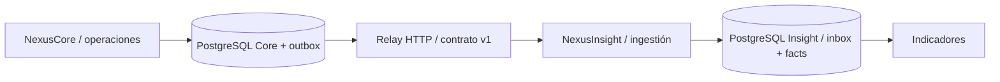

# NexusCore

MVP de gestión operativa multisectorial con una primera implementación comercial para una empresa de repuestos.

**Stack:** React y JavaScript en la interfaz, NestJS y TypeScript en la API, y PostgreSQL para la persistencia.

[Demo estática en GitHub Pages](https://idrovodario16.github.io/nexuscore-platform/)

## NexusWorkspace · operación comercial local

Workspace conecta la interfaz con NestJS y PostgreSQL. Permite iniciar sesión, elegir una empresa, registrar envíos, cambiar su estado, consultar el historial y ver indicadores sobre el conjunto filtrado. Operación puede avanzar los envíos. Supervisión y administración también pueden cancelarlos.

El flujo comercial enlaza **Inventario → Clientes → Ventas y cobros → Despachos**. Registra un producto y una entrada de unidades, crea un cliente y confirma una venta. La venta descuenta el stock y genera el despacho en una sola transacción. Puedes registrar un cobro ya recibido y seguir el envío hasta la entrega. Supervisión puede cancelar un despacho de venta pendiente y sin cobro, lo que repone las unidades. Este piloto registra cobros operativos. La factura fiscal, la contabilidad y las devoluciones posteriores al despacho requieren flujos adicionales.

1. Copia `.env.example` a `.env` y define `WORKSPACE_DEMO_PASSWORD` con una contraseña ficticia de al menos 12 caracteres.
2. Ejecuta `docker compose up -d --build` y espera a que la API esté disponible en `http://localhost:3000/health`.
3. Ejecuta `docker compose exec api npm run seed:workspace` para preparar las dos empresas de prueba.
4. Abre [Workspace local](http://localhost:8080) e inicia sesión con la contraseña que definiste.

| Cuenta de prueba | Acceso |
| --- | --- |
| `operador@atlas.example` | Atlas Logística |
| `supervisor@atlas.example` | Atlas Logística y permiso para cancelar |
| `operador@pacifico.example` | Pacífico Envíos |
| `admin@nexus.example` | Ambas empresas y permiso para cancelar |

Recorrido sugerido: registra un producto, recibe unidades, crea un cliente y confirma una venta. Registra el cobro en **Ventas y cobros** y pulsa **Ver despacho** para llevarlo de **Pendiente** a **En tránsito** y **Entregado**. Revisa el historial, las existencias y los importes cobrados y pendientes en **Resumen**. Cambia de cuenta para comprobar el aislamiento. En desarrollo con Vite, abre `http://127.0.0.1:5173/?workspace=1` con la API local en el puerto 3000.

El piloto utiliza credenciales de prueba, una cookie de sesión y autorización por empresa en la API. El Compose local habilita HTTP de desarrollo. El tablero consulta Core y la outbox mantiene el contrato v1. Insight, Connect y Portal quedan para fases posteriores. La demo estática de Pages sigue funcionando por separado.

## Qué puedes probar en la demo estática

1. Consulta 24 operaciones ficticias de logística, comercio y servicios.
2. Crea una operación con título, sector y monto en dólares.
3. Avanza de **Pendiente → En curso → Completada**, o cancela desde un estado activo.
4. Filtra operaciones por sector, estado, mes y título.
5. Exporta sus eventos JSON para analizarlos en NexusInsight. La exportación incluye todas las operaciones, aunque haya filtros activos.

La barra lateral incluye el enlace al otro producto y una vista que explica la integración. La muestra usa **Atlas Demo Group**, una organización inventada; no procede de clientes ni sistemas reales.

## Demo web frente a backend

| Capacidad | Demo pública | Workspace local | API v1 para scripts |
| --- | --- | --- | --- |
| Datos | Ficticios en el navegador | Persistentes en PostgreSQL | Persistentes en PostgreSQL |
| Operaciones | Muestra de logística, comercio y servicios | Inventario, clientes, ventas, cobros y despachos con historial | Alta, listado y cambios de operaciones generales |
| Acceso | Demostración abierta | Sesión y permisos por empresa | Clave de integración y organización configurada |
| Integración | Exportación e importación manual de JSON | Tablero conectado a Core | Relay HTTP con checkpoint y reintentos |

**GitHub Pages sirve la demo estática con datos ficticios.** Workspace usa la API y PostgreSQL en el entorno local de Docker. Sus operaciones, cuentas de prueba y datos se guardan localmente.

## Cómo se complementan

**NexusCore produce y administra las operaciones. NexusInsight recibe sus instantáneas y calcula indicadores.** No comparten base de datos ni requieren desplegarse juntos.



En el navegador, el usuario transporta el mismo contrato como archivo JSON. En servidores, el relay de [nexus-architecture](https://github.com/idrovodario16/nexus-architecture/tree/main/scripts) lee la outbox y confirma su cursor después de una transacción exitosa en Insight. Cada registro tiene una revisión creciente; el consumidor usa inbox para deduplicar eventos y un UPSERT condicional para evitar degradar el estado.

**Uso independiente:** registra y consulta operaciones sin NexusInsight. La outbox conserva eventos aunque no haya consumidores activos.

## Ejecutar solo la demo

Requisitos: **Node.js 22.12+** (Node 24 también es compatible) y npm.

```bash
git clone https://github.com/idrovodario16/nexuscore-platform.git
cd nexuscore-platform
npm ci
npm run dev -- --port 5173
```

Abre http://localhost:5173. Para producir archivos estáticos: `npm run build`. `npm run preview` sirve la compilación; `dist/` es el resultado. Vite usa rutas relativas, compatibles con el subdirectorio del repositorio en Pages.

## Ejecutar backend, base y demo con Docker

Requisitos: Docker Engine/Desktop activo y Docker Compose v2.

```bash
cp .env.example .env
docker compose up --build -d
docker compose exec api npm run seed
```

En PowerShell, usa `Copy-Item .env.example .env`. Las variables de ejemplo son **valores ficticios exclusivos para desarrollo local**. Cambia las claves y contraseñas antes de desplegar. Los puertos se vinculan a 127.0.0.1 para no exponer el entorno local a la red.

| Servicio | Dirección |
| --- | --- |
| Workspace | http://localhost:8080 |
| Demo estática | http://localhost:8080/?demo=1 |
| API / salud | http://localhost:3000/health |
| PostgreSQL | localhost:5433 |

Las migraciones se aplican antes de arrancar la API. El seed `npm run seed` carga las operaciones de muestra de la API v1. Para preparar las cuentas de Workspace usa `npm run seed:workspace`. `docker compose down` detiene los servicios sin borrar los datos. **No uses `down -v` si quieres conservarlos.**

### API sin Docker

Con PostgreSQL 16 disponible, exporta las variables de `.env` en tu shell (o usa el cargador de variables de tu entorno); estos comandos no cargan ese archivo automáticamente.

```bash
cd api
npm ci
npm run build
npm run migrate
npm run seed
npm start
```

### Probar una ruta real

```bash
curl http://localhost:3000/v1/operations \
  -H "Authorization: Bearer $API_KEY" \
  -H "X-Organization-ID: $ORGANIZATION_ID"
```

En PowerShell usa `curl.exe` y las variables `$env:API_KEY`, `$env:ORGANIZATION_ID`. Consulta el [contrato OpenAPI de v1](docs/openapi.json) para cuerpos y respuestas. Las rutas v1 usan una clave y la organización configurada para esa instancia. Las rutas de Workspace comprueban la sesión y la membresía en cada solicitud.

## Arquitectura y archivos

```text
src/                     React, modelo de demo y muestra
api/src/domain/          Entidad, validación y reglas de transición
api/src/application/     Casos de uso y puerto de repositorio
api/src/infrastructure/  Adaptador PostgreSQL y outbox
api/src/interfaces/      Controladores HTTP y autorización NestJS
api/db/                  Esquema SQL inicial
api/test/                Pruebas de dominio y PostgreSQL/HTTP
```

Ambos incluyen `contracts/`, `examples/`, `docs/`, Dockerfiles y CI. Se empieza con **monolitos modulares**, uno por producto, para mantener reglas y transacciones claras. No se presentan como una red de microservicios ya implementada; las fronteras permiten extraer servicios cuando haya necesidad demostrada.

## Indicadores y reglas

- Sectores: logística (`logistics`), comercio (`retail`) y servicios (`services`). Son configuraciones de ejemplo del mismo modelo operativo.
- Monto: entero en centavos USD, entre 0 y 1.000.000.000 centavos; no se mezclan monedas.
- Valor completado: suma de montos con estado `completed`. **No equivale a ingresos contables, beneficio ni facturación.**
- Tasa de finalización: completadas / total × 100; con cero registros devuelve 0.
- Estados terminales: `completed` y `cancelled`. No se pueden reabrir en Core.
- Revisionado: inicia en 1; cada cambio de estado aumenta la revisión en la misma transacción que su evento.
- El esquema usa UUID, fechas ISO 8601 con zona horaria y contrato versionado. No hay borrado físico de operaciones en la API.

## Pruebas y CI

```bash
npm ci
npm test
npm run build
```

Para NestJS: `cd api`, `npm ci`, `npm test`. Las pruebas de integración requieren PostgreSQL y `RUN_INTEGRATION=1`, junto con las variables de conexión y acceso. Sin ese indicador se omiten explícitamente; no se simula una validación real de PostgreSQL. CI levanta PostgreSQL 16 y ejecuta esas pruebas. Ver [estrategia y criterios](docs/testing.md).

La demo principal se publica en **GitHub Pages** mediante `.github/workflows/pages.yml` al actualizar `main`. El flujo ejecuta pruebas y compila React antes de desplegar `dist/`. GitHub Pages aloja solo el frontend; las APIs y PostgreSQL se ejecutan por separado. Las versiones previas de Sites son alojamientos independientes y no se actualizan con este flujo. El historial de Actions muestra el estado real de cada publicación.

## Alcance y evolución

Este MVP permite demostrar una solución completa en su flujo principal, con límites explícitos. No está listo para manejar datos sensibles ni operar como SaaS productivo. Ver [requisitos y backlog](docs/requirements.md), [arquitectura](docs/architecture.md) y [seguridad](SECURITY.md).

Siguientes etapas: interfaz conectada a API, identidad OIDC/RBAC, múltiples organizaciones por despliegue con pruebas de aislamiento, auditoría de actor y cambios, formularios configurables, métricas temporales avanzadas, broker de mensajes y observabilidad distribuida. La analítica predictiva no está implementada.

Autor: **Darío Idrovo** · Licencia [MIT](LICENSE).

Consulta [cómo se publicaron las demos](docs/deployment.md), sus límites y cómo actualizar el alojamiento.


## Integración

Consulta [Nexus Architecture](https://github.com/idrovodario16/nexus-architecture) para el recorrido de exportación/importación JSON y la ejecución del relay HTTP. Las demos no se sincronizan automáticamente.
